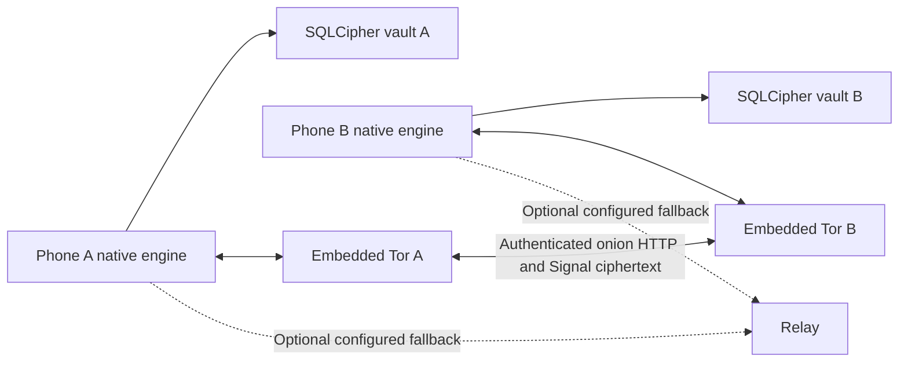

# Crypto Pigeon

The **0.4.0-standalone Android engine** runs its UI, vault, SQLCipher, libsignal and Tor on the phone. Two users exchange signed invites and communicate over Tor v3 onion services without an application cloud server, laptop/home relay, Firebase, Google Play Services or Orbot. Both phones still need internet access to the public Tor network.

The Node daemon supports the same direct protocol. An application relay remains optional for compatible registered accounts. This independent application is unaudited; using libsignal 0.96.4 does not make it equivalent to Signal.

See [Native Android implementation](docs/native-android-implementation.md) for current details. Older [desktop](docs/desktop-release.md), [relay beta](docs/verified-beta-2026-11-01.md) and [vault/USB](docs/vault-backup-and-android.md) reports describe historical workflows, not current Tor acceptance.

## Components

| Location | Responsibility |
| --- | --- |
| apps/mobile-android/native | Standalone launcher, native vault/Signal engine, loopback API, Tor and foreground service |
| apps/local-ui | Shared React UI, signed QR contacts, files, voice notes and settings |
| apps/local-daemon | Desktop SQLCipher/Signal engine, Tor routing and optional relay adapter |
| packages/protocol | Wire validation and signed invite encoding |
| packages/shared-types | Payload/manifest types |
| apps/relay-server | Optional PostgreSQL-backed relay, prekeys and temporary ciphertext |
| apps/admin-cli | Optional relay administration |
| apps/mobile-android/app | Legacy wrapper; standalone work is in the native module |



## Connect two phones

1. Install `artifacts/crypto-pigeon-standalone.apk`, create separate vaults and save each external `segment-07.cp7` through the document picker. Choosing a username self-activates locally in direct mode.
2. Allow notifications and unrestricted battery usage in Settings. Unlock and wait for Tor bootstrap to reach 100%.
3. Open Your identity, exchange the full signed QR or `pigeon://invite?v=2&...` URI, and import each other's invite. A UID alone cannot route a serverless message.
4. Send messages, files or voice notes. Offline recipients leave encrypted data queued on the sender; direct attachment retrieval needs the sender available too.

Exchange invites in person or through an authenticated channel. The signature binds fields/keys; it does not identify a human if an attacker substitutes another signed invite. Safety Number inspection remains available.

## Vault compatibility

Libsignal remains pinned to **0.96.4** in Node and Android. Existing Argon2id **64 MiB / 3 iterations / parallelism 1**, HKDF domain separation, AES-256-GCM wrapped VMK, opaque Signal records and **7-of-7 XOR fragments** are preserved.

`segment-07.cp7` is the external seventh segment. An encrypted `.cpvault` storage bundle does not bypass reconstruction or credentials. Android's multi-vault catalog separates roots, fragments, keys, databases, contacts, attachments and onion identities. Preserve existing app data/external files during upgrades and save replacements after password rotation as prompted.

Cloud backup is optional. Never share credentials, private keys, browser fragments or external segment files as contact invites.

## Transport and background delivery

Settings exposes `DIRECT_TOR_P2P` (default), `HYBRID_TOR_RELAY` and `RELAY_ONLY`. Direct mode uses onion routes exclusively. Hybrid permits configured relay fallback for supported accounts. Local activation does not automatically provision an account on an arbitrary legacy relay; existing relay accounts retain their original workflow.

Each vault's onion key stays in SQLCipher and Tor memory. A separate authenticated peer listener accepts pinned device signatures. Onion hosts use SOCKS domain forwarding, not system DNS. Runtime status reports the actual bootstrap percentage and route availability.

Signal state and retry ciphertext commit together. Direct acknowledgements follow durable encrypted inbox persistence. Transactional decryption/deduplication then persist messages and generate encrypted receipts. Retries reuse original bytes.

Attachments use per-file AES-256-GCM and authenticated 64 KiB chunks with a **25 MiB** limit. The sender spools encrypted chunks; the recipient verifies tags, nonces, size and digest before caching. Voice notes use the same path and authenticated loopback media playback.

The Android foreground service keeps an unlocked engine alive across WebView closure/screen-off, with bounded packet CPU/Wi-Fi locks. Notifications say **New encrypted message**, without sender or plaintext. Vault Lock/Panic Lock stops direct transport. Cold process restart/reboot requires unlock again; credentials are not saved for automatic reconstruction.

Force-stop, manufacturer battery controls, denied permissions and unavailable networks can interrupt delivery. The Settings battery flow assists configuration; it is not a substitute for physical-device testing.

## Build and verification

Requirements: Node 22+, npm, JDK 17, Android SDK platform 36 and the existing Gradle wrapper. Do not print environment files or credentials.

```powershell
npm.cmd ci
npm.cmd run build
npm.cmd test
node --import tsx --test scripts/back-navigation.test.mjs scripts/vault-fragments.test.mjs
npm.cmd run android:native:build -- --tests --jvm-tests
```

The native helper writes `artifacts/crypto-pigeon-standalone.apk`, the instrumentation APK and `artifacts/native-android/build.log`. **--jvm-tests runs JVM tests; --tests only builds device instrumentation.** It does not run tests on phones.

Desktop Tor development on Windows x64:

```powershell
node scripts/prepare-tor.mjs
npm.cmd run dev:daemon
```

The preparation script verifies the pinned official Tor expert bundle and extracts its executable/notices. Desktop staging includes it. Other platforms can supply a supported Tor executable through `TOR_BINARY`. Keep the local daemon/UI bound to loopback.

Optional network check:

```powershell
node scripts/tor-live-check.mjs
```

This creates isolated desktop vaults and app-owned Tor processes. It is separate from the mandatory gates and Android screen-off acceptance.

Vite splits React, motion, icon and QR dependencies into vendor chunks instead of increasing the bundle-warning threshold. Final logs and exact source inventory belong under `artifacts/serverless-p2p/`.

## Acceptance and limitations

The suite covers vault/KDF compatibility, authenticated encryption, real Signal sessions, rollback, exact ciphertext retries, attachment integrity, invite signatures/pinning, Node/Android signature compatibility and routing. A desktop Tor exchange and successful JVM/APK builds do not establish Android microphone, service or Doze behavior.

Follow the [two-phone checklist](docs/native-android-implementation.md#two-phone-acceptance-still-required): different networks without USB, simultaneous sends, files and real voice notes, screen-off/Doze, offline/restart retries, lock shutdown and vault isolation.

Direct mode has no third-party offline mailbox. It requires an available recipient and retains queues on the sender. Tor does not eliminate endpoint compromise, denial of service, screenshots or traffic analysis. Disappearing messages provide best-effort local deletion.

Optional relays still require HTTPS/WSS, correct authentication/hostname configuration and PostgreSQL/credential protections; see [desktop release](docs/desktop-release.md), [architecture](docs/architecture.md) and [protocol flow](docs/protocol-flow.md). Relay routes expose connection/routing metadata to that infrastructure.

This source archive has no Git metadata. Upgrade checkpoints are under `artifacts/checkpoints/pre-serverless-p2p/`; do not reset user app data to reproduce a build. No authoritative application distribution license is included. Third-party binary licenses still apply; Tor preparation/staging preserves notices. Release signing, distribution licensing and independent security review remain separate release tasks.
