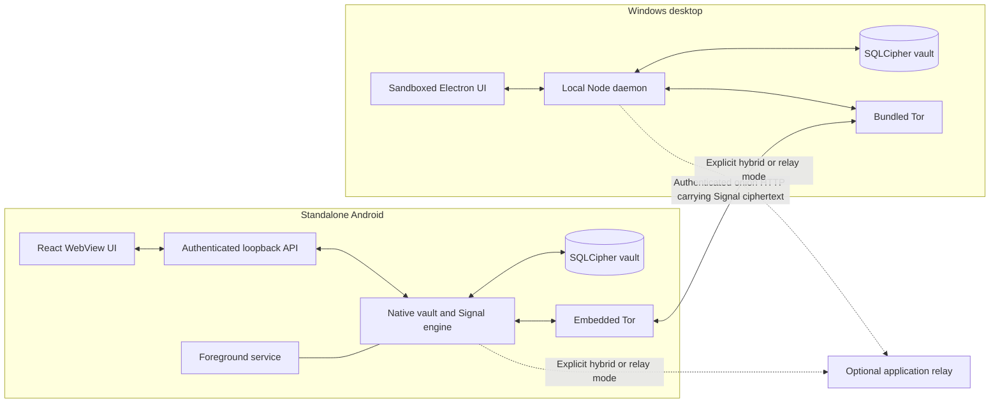

<p align="center"></p>
<h1 align="center">Crypto Pigeon</h1>
<p align="center"><strong>Encrypted messages. Local vaults. Direct Tor connections.</strong></p>
<p align="center">Standalone Android · Windows desktop · Signal protocol · SQLCipher · Tor v3</p>

Crypto Pigeon keeps vault keys, Signal sessions and message history on your devices. Android runs its own native engine and embedded Tor process; Windows bundles a local Node daemon and Tor. Peers exchange signed invitations and communicate over public Tor v3 onion services without an application-owned cloud server in direct mode.

**Status: private beta, with signed Android release packaging.** The desktop public Tor suite and an earlier physical Android-phone/laptop suite passed. The newly signed production APK has build, signature and regression evidence, but has not been installed and tested on a physical phone. This independent application is unaudited; using libsignal does not make it equivalent to Signal.

[Release evidence](artifacts/serverless-p2p/RELEASE-READINESS-REPORT.md) · [Physical-device report](artifacts/serverless-p2p/ONE-PHONE-LIVE-REPORT.md) · [Build and signing guide](docs/release-packaging.md) · [Android internals](docs/native-android-implementation.md)

## Contents

- [Capabilities](#capabilities)
- [Architecture](#architecture)
- [Platforms and artifacts](#platforms-and-artifacts)
- [Get started](#get-started)
- [Build from source](#build-from-source)
- [Transport and recovery](#transport-and-recovery)
- [Vaults, backups and updates](#vaults-backups-and-updates)
- [Security model](#security-model)
- [Verification](#verification)
- [Troubleshooting](#troubleshooting)
- [Repository map](#repository-map)
- [Contributing and licensing](#contributing-and-licensing)

## Capabilities

| Capability | Implementation |
| --- | --- |
| Direct messaging | App-owned Tor v3 onion services on Android and Node; no application relay required in direct mode |
| End-to-end encryption | libsignal **0.96.4**, local sessions, pinned identity/prekeys and encrypted receipts |
| Offline pairing | Compressed, signed v2 `pigeon://invite` QR codes and URIs |
| Durable delivery | SQLCipher inbox/outbox, original-ciphertext retries and receiver deduplication |
| Files and voice | AES-256-GCM attachments, authenticated **64 KiB** chunks and a **25 MiB** configured file limit |
| Android background delivery | Shared native runtime, foreground service, private generic notifications and bounded packet wake locks |
| Network recovery | Default-network/validation callbacks, debounced Tor renewal and readiness-driven queue wakeups |
| Vault isolation | Per-vault databases, fragments, attachments, Signal state and onion identities |
| Optional relay compatibility | Explicit hybrid/relay modes for compatible registered accounts |
| Desktop isolation | Sandboxed Electron renderer; native cryptography runs in a separate bundled Node process |

Direct mode still needs internet access to the **public Tor network**. Android does not require Orbot, Firebase, Google Play Services, a laptop or a home relay. There is no third-party offline mailbox in direct mode: the sender keeps encrypted data queued until delivery is possible. Attachment retrieval also needs the sender's encrypted spool to remain available.

## Architecture



Each unlocked vault restores its own onion identity from SQLCipher. Tor maps an ephemeral onion service to a separate loopback peer listener; that service does not expose the vault/settings API. Outbound onion names use SOCKS domain forwarding rather than system DNS.

Peer requests sign the sender, timestamp, nonce, method, path and exact body using a pinned device key. Signal state and outgoing ciphertext commit together. The recipient acknowledges an envelope after durable inbox persistence, then decrypts/deduplicates it and generates encrypted delivery/read receipts. A retry reuses the original envelope and ciphertext instead of advancing the ratchet again.

Attachments are encrypted separately and retrieved from the sender in authenticated chunks. The recipient verifies tags, nonces, size and digest before completing its local cache. Voice notes use the same attachment path.

## Platforms and artifacts

| Target | Current build | Scope |
| --- | --- | --- |
| Android | `0.4.0-standalone`, version code **2** | API 26+; builds against/targets API 36; arm64-v8a and x86_64 |
| Windows | Desktop `0.1.0`, x64 NSIS installer | Bundled Node, UI, Tor and native dependencies; Authenticode signing is not configured |
| macOS / Linux | Packaging targets declared | Platform-specific builds, dependencies and signing are not validated by the Windows report |

These **local artifacts were verified on 6 November 2026**. Binaries are ignored by Git; this source update does not publish a GitHub Release or attach downloadable installers. Building with another signing identity produces a different APK hash.

| Artifact | Local output | Bytes |
| --- | --- | ---: |
| Signed Android production APK | `artifacts/crypto-pigeon-release.apk` | 56,725,694 |
| Android debug standalone APK | `artifacts/crypto-pigeon-standalone.apk` | 66,427,107 |
| Windows installer | `artifacts/desktop/Crypto-Pigeon-Setup-0.1.0-x64.exe` | 164,098,970 |

<details>
<summary>Recorded SHA-256 hashes and Android signing certificate</summary>

```text
Android production APK
bd2e2aa947eda6b7355c6957c7ce5c11f071bb15fff60604befcb9f11c94918f

Android debug standalone APK
1928e040de916930ef1dbca6115c2b526e655274298b8bb9837d54cca5b21ba4

Windows installer
140155a495a6e79b356d5d7d72d56acec2c8c4b5945ee0df054ec9522b6f705e

Android signing certificate SHA-256
4b8b04abc0121685caad1aed95bfb59ee762b5e72617ee84ff2ce4400107b678
```

The Android release passed `apksigner` verification with one RSA-4096 signer and APK Signature Scheme v2. The [release report](artifacts/serverless-p2p/RELEASE-READINESS-REPORT.md) records the source baseline and the archived APK used by the earlier physical-device run. That historical debug APK differs from the rebuilt debug artifact above.

</details>

## Get started

### Android

1. Install the signed production APK from a trusted build. Preserve existing app data and external vault files; review the [update constraints](#vaults-backups-and-updates).
2. Create a vault and save external `segment-07.cp7` through the document picker. Choosing a username self-activates the identity locally in direct mode.
3. Allow notifications and configure unrestricted battery usage through Settings. Grant microphone access when recording voice notes.
4. Unlock and wait for Tor bootstrap to reach **100%**. Publication/propagation and the peer's availability still affect first delivery.
5. Open **Your identity**, exchange full signed QR codes or v2 invitation URIs, and import the other person's invitation on **both** devices.
6. Open the paired conversation and send messages, files or voice notes.

A public UID alone cannot route a serverless message. Exchange invites in person or through an authenticated channel and compare Safety Numbers. A signature proves control of the invite's key; a substituted signed invite can still belong to an attacker.

### Windows

Install the Windows package from your trusted build, then choose **Start with Tor** on a fresh profile. Create/unlock a vault and exchange invitations as above. Existing relay accounts can retain their relay onboarding workflow.

Desktop state lives under Electron's user-data directory, normally `%APPDATA%/Crypto Pigeon`. Its `vault` directory and persistent Chromium storage belong to the same profile: preserve the complete profile when backing up. The authenticated daemon binds to `127.0.0.1:17421`; keep that API on loopback.

## Build from source

### Requirements

| Tool | Requirement |
| --- | --- |
| Node.js | **22+**, with npm; use the committed lockfile |
| Android Java | **JDK 17** |
| Android SDK | Platform **36**, platform tools and suitable build tools; recorded signature verification used **35.0.0** |
| Gradle | Included wrapper; configure `JAVA_HOME` and `ANDROID_HOME` or `ANDROID_SDK_ROOT` |
| Desktop packaging | Windows x64 for the verified installer workflow |

Commands below use Windows PowerShell and `npm.cmd`.

```powershell
git clone https://github.com/Mithunjagan/Crypto-pigeon.git
Set-Location Crypto-pigeon
npm.cmd ci
npm.cmd run build
npm.cmd test
```

Direct Tor messaging does not require provisioning the optional relay database or operator credentials. For local relay development, `npm.cmd run setup:dev` creates an ignored `.env` and preserves an existing one. Do not print or commit it. See [deployment](docs/deployment.md) and the legacy sections of [desktop release](docs/desktop-release.md) for relay setup.

### Android debug and instrumentation builds

```powershell
npm.cmd run android:native:build -- --tests --jvm-tests
```

Outputs include the debug standalone APK and `artifacts/native-android/build.log`. **`--jvm-tests` executes JVM tests; `--tests` builds device instrumentation without running it on a phone.** Generate native interoperability fixtures with `npm.cmd run android:native:fixtures` before running the corresponding device tests.

### Signed Android production build

```powershell
node scripts/prepare-release-signing.mjs
npm.cmd run android:native:build -- --release
```

The helper creates an RSA-4096 JKS valid for 10,000 days if absent, or validates/reuses the existing key. Credentials stay under ignored `artifacts/keys/` with restricted local access. **Securely back up both the JKS and signing properties.** Losing that identity can prevent future updates. Never commit signing material or include it in logs/issues.

Release builds disable debugging and shrinking to preserve JNI/WebView bridges. The signed production output is separate from the debug APK. Verify it using your SDK tools:

```powershell
# Configure JAVA_HOME and adjust the SDK/build-tools path to your installation.
& "$env:ANDROID_HOME/build-tools/35.0.0/apksigner.bat" verify --verbose --print-certs artifacts/crypto-pigeon-release.apk
Get-FileHash -Algorithm SHA256 artifacts/crypto-pigeon-release.apk
```

See the [signing guide](docs/release-packaging.md) for details.

### Windows development and packaging

```powershell
node scripts/prepare-tor.mjs
npm.cmd run desktop:dev
```

Tor preparation verifies the pinned official Windows expert bundle before extracting its executable/notices. To run only the Node daemon, use `npm.cmd run dev:daemon` and keep its dynamically selected endpoint private. On other platforms, the daemon can use a suitable executable through `TOR_BINARY`; this does not establish desktop packaging support there.

```powershell
npm.cmd run desktop:installer
npm.cmd run desktop:smoke
```

Packaging stages the daemon, UI, Tor/notices and locked production dependencies, then loads native modules in bundled Node, outside Electron's ABI. Staging refuses to overwrite a nonempty `artifacts/desktop-runtime`; archive that generated directory inside the workspace before rebuilding. Do not move or delete user vault/profile directories.

## Transport and recovery

| Mode | Delivery policy |
| --- | --- |
| `DIRECT_TOR_P2P` | Default. Only authenticated onion transport; unavailable peers leave ciphertext queued |
| `HYBRID_TOR_RELAY` | Prefer Tor; permit configured fallback for compatible registered relay accounts |
| `RELAY_ONLY` | Existing activated relay-account workflow |

Local activation does not register a standalone identity with an arbitrary legacy relay. Selecting hybrid mode cannot make that relay support the account.

Android watches default-network replacement and validation recovery while the unlocked foreground service is active. It cancels obsolete outbound requests, clears reconnect backoff and requests `DisableNetwork=0`/`NEWNYM`, coalescing renewals with a ten-second cooldown. Tor circuit/publication readiness wakes the durable queue. Lock/service shutdown unregisters the callback and stops transport.

The desktop daemon also wakes its serialized queue on bootstrap, first publication or circuit/liveness recovery. Event bursts coalesce and periodic retries remain available. Neither recovery path replaces onion keys or re-encrypts queued Signal payloads.

**No new physical Wi-Fi/mobile handover latency has been measured.** Scheduling regressions pass, but do not establish a reduction from the earlier approximately 235-second offline recovery observation. Tor construction, descriptor propagation and remote-peer outages can still dominate delivery time.

## Vaults, backups and updates

The implementation preserves Argon2id at **64 MiB / 3 iterations / parallelism 1**, HKDF domain separation, AES-256-GCM VMK wrapping and **7-of-7 XOR fragments**. All seven fragments are required; this is not a threshold scheme that tolerates missing pieces. An encrypted `.cpvault` bundle does not bypass the quorum or credentials. Save replacement external files when prompted after password rotation.

Android's multi-vault catalog separates roots, fragments, device-key aliases, databases, contacts, attachments and onion identities. Cold process restart or reboot requires explicit unlock; the passphrase is not saved for automatic reconstruction. Optional cloud backup does not remove device-bound key constraints. Never share credentials, fragments or backup files as contact invitations.

| Android package | Purpose |
| --- | --- |
| `app.cryptopigeon.nativeclient` | Production release |
| `app.cryptopigeon.nativeclient.debug` | Debug/testing build |

These packages have separate sandboxes and Keystore identities. Production can coexist with debug, but **does not migrate its vaults or update that package in place**. Do not uninstall, clear data or copy device-bound key material to force an upgrade. Subsequent production updates must retain the package ID and signing identity and advance the version code as appropriate.

## Security model

- Signal encrypts message/control payloads; SQLCipher protects persisted vault state. Attachment chunks have separate authenticated encryption.
- Signed invitations pin device-auth keys, Signal identity/prekeys and onion routes. Reimport preserves established sessions; identity-change guards remain enforced.
- UIs use authenticated loopback APIs. Electron disables renderer Node integration, enables context isolation/sandboxing and restricts navigation/networking to its local application origin.
- Android notifications use **New encrypted message**, without sender names or plaintext. Packet CPU/Wi-Fi leases are bounded.
- Vault/Panic Lock stops direct transport. Force-stop, denied permissions, OEM process killing and unavailable networks can interrupt delivery.

Tor does not protect an unlocked/compromised endpoint from malware, screenshots, copied text, denial of service or all traffic analysis. Disappearing messages are best-effort retention controls. Optional relay infrastructure can observe connection/routing metadata and requires its own authentication, TLS, deployment and backup protections.

See [threat model](docs/threat-model.md), [protocol flow](docs/protocol-flow.md) and [architecture](docs/architecture.md). Some older documents describe the relay-first design; use the current dated verification reports for tested scope.

## Verification

Results recorded on **6 November 2026**:

| Check | Result | Scope |
| --- | --- | --- |
| Workspace build | PASS | All workspaces; zero Vite chunk warnings |
| Core + desktop tests | **28 + 3 passed** | Vault/Signal/queues/invites/attachments and desktop policies |
| Navigation/fragment regressions | **6 passed** | Existing back-stack and fragment behavior |
| Tor control/HTTP regressions | **4 passed** | Async replies, public cache, readiness wakeups and encrypted chunk transport |
| Native JVM tests | **14 passed** | Includes network-state transitions; zero failures/errors |
| Android release checks | PASS | RSA-4096/v2 signature; Tor, Signal and SQLCipher libraries for both ABIs |
| Packaged Windows smoke | PASS | Outside-checkout onboarding, sandboxing, local authentication, storage persistence and shutdown |
| Real desktop public Tor | PASS | Simultaneous text, maximum Unicode, exact attachment bytes and cold-reopen offline retry |
| Earlier physical phone ↔ laptop | PASS | Run `b45bfd8c606037b3`; nine native checks; historical debug APK |
| New production APK on a phone | Not run | Separate production package/signing identity |
| Physical Wi-Fi/mobile handover | Not run | Scheduling tests do not establish network-switch latency |

The historical phone/laptop run covered verified pairing, Tamil/emoji text, visible chat/read receipts, exact file integrity both ways, actual microphone payload integrity both ways, screen-off receipt, offline recovery and lock shutdown. All peer traffic used real public Tor. ADB was limited to setup, local actions and inspection, without forwarding peer messages or media.

The app was backgrounded for 70 seconds, then the display was slept before receipt. This established non-interactive receive-time persistence, not extended Doze/OEM reliability. Speaker playback was not automatically asserted. The new production APK was built afterward and does not inherit a new hardware pass.

### Repository gates

```powershell
npm.cmd run build
npm.cmd test
node --import tsx --test scripts/back-navigation.test.mjs scripts/vault-fragments.test.mjs
node --test scripts/tor-bootstrap.test.mjs scripts/tor-http-regression.test.mjs
npm.cmd run android:native:build -- --tests --jvm-tests
```

### Real network checks

```powershell
node scripts/tor-live-check.mjs
# Requires one authorized Android phone, SDK tools and microphone permissions:
node scripts/one-phone-laptop-tor-live.mjs
```

These use isolated runtimes/vaults and public Tor. The phone runner performs installation and device actions; inspect its scope before using your phone. Do not clear app data or substitute USB forwarding for public Tor proof. A passing isolated run is not broad device, network or security certification.

Reports are tracked; raw logs, generated fixtures, binaries, hardware-run state and signing credentials stay local and ignored. Some evidence links within reports therefore resolve only in the original verified workspace.

## Troubleshooting

| Symptom | Check |
| --- | --- |
| Tor connects slowly or first delivery stalls | Internet/Tor reachability, bootstrap/publication status, descriptor propagation and peer availability |
| Message remains queued | Import full invites both ways; verify pinned routes and that the peer is unlocked/online |
| Attachment remains pending | Keep the sender online/unlocked for encrypted chunk retrieval; inspect sanitized transport status |
| No background notification | Notification permission, unrestricted battery settings, foreground service and OEM restrictions |
| Cold unlock fails | Preserve credentials, full fragment quorum, external segment and device-bound state; never reset app data as a diagnostic shortcut |
| Production cannot see debug vaults | Separate package sandboxes; installation is not migration |
| Desktop cannot start | Bundled runtime and port `17421`; preserve the profile while investigating |
| Installer staging is nonempty | Archive only the generated runtime before rebuilding; see the packaging guide |

## Repository map

```text
apps/
  desktop/                 Electron shell, onboarding and installer configuration
  local-daemon/            Node vault/Signal engine, Tor and optional relay adapter
  local-ui/                Shared React UI, QR pairing, messages, media and settings
  mobile-android/native/   Standalone Android, Tor, Keystore and foreground service
  mobile-android/app/      Legacy wrapper; not the standalone native engine
  relay-server/            Optional PostgreSQL relay, accounts and prekeys
  admin-cli/               Optional relay administration
packages/
  protocol/                Wire validation, crypto helpers and invitation encoding
  shared-types/            Shared payload/manifest definitions
  tests/                   Core and protocol regression suites
scripts/                   Build, packaging, signing, audit and live verification
docs/                      Architecture, deployment, platform and release guides
artifacts/serverless-p2p/  Tracked Markdown reports; generated evidence is ignored
```

## Contributing and licensing

Start with the release report and platform guide. Keep changes incremental and run checks appropriate to affected behavior. Preserve vault formats, the libsignal pin, identity checks and original retry bytes. Reports must distinguish repository fixtures from real external-system tests.

Never commit `.env` files, signing material, vaults, external fragments or raw device data. `node scripts/audit-git-baseline.mjs` scans staged blobs before a commit. Local source checkpoints and signed artifacts belong outside tracked source.

This repository does **not** currently include an authoritative application distribution license. Do not infer one from public source availability. Third-party licenses still apply; Tor preparation/staging preserves its notices, and UI notices live under `apps/local-ui/public/licenses/`. Windows code signing, distribution licensing, broader hardware acceptance and an independent security review remain separate release work.
